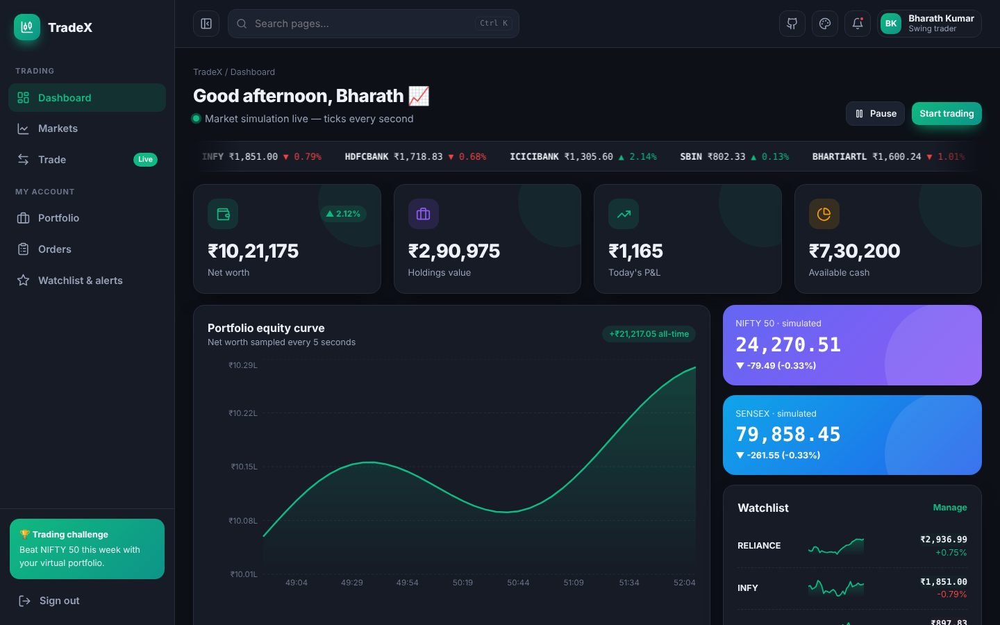
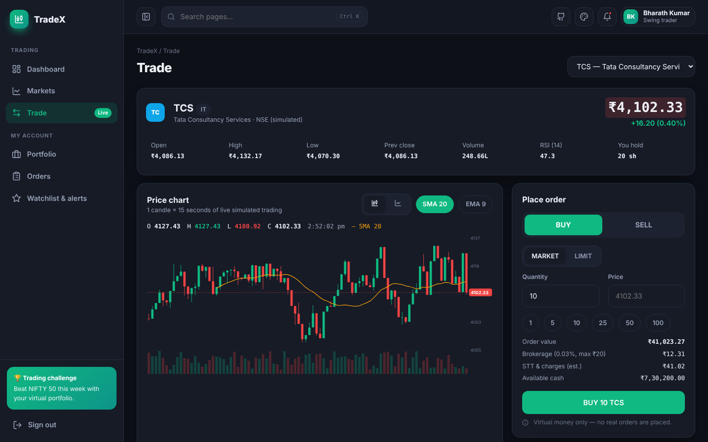
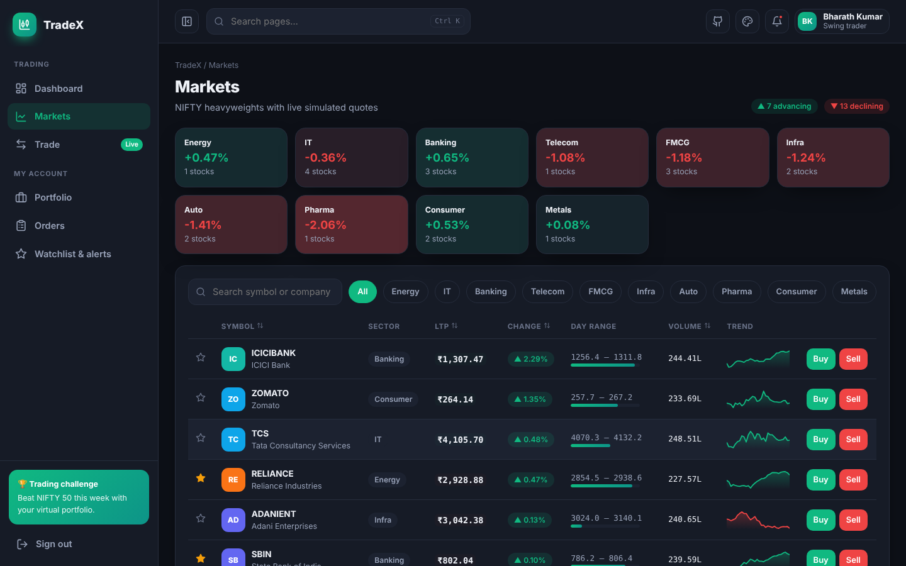
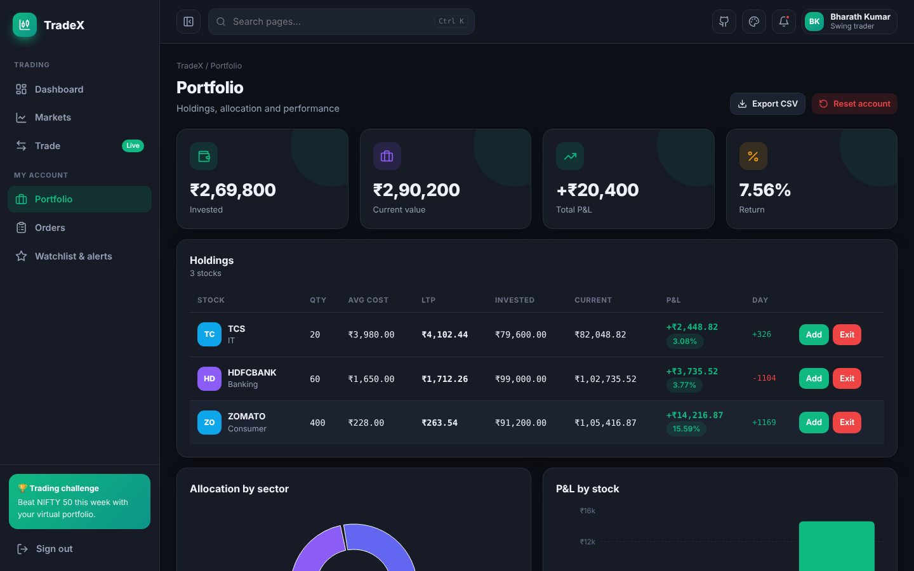
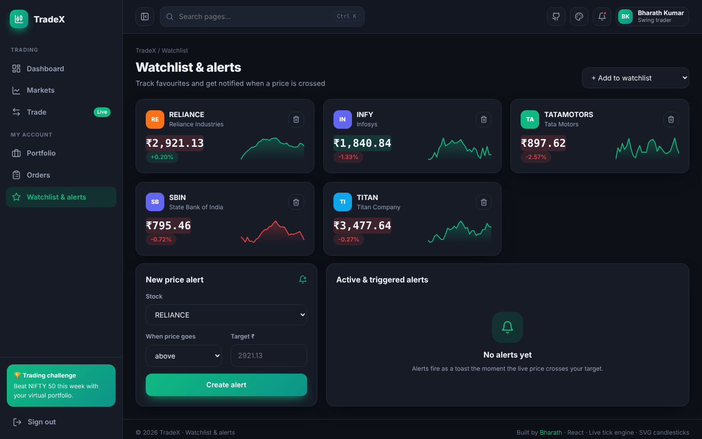
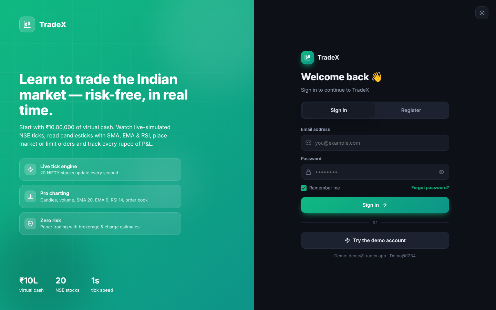

<div align="center">

# 📈 TradeX — Stock Trading Simulator

**Paper-trade 20 NIFTY heavyweights with a live tick engine, pro candlestick charts, an order book, limit orders and full portfolio analytics — all in the browser.**

[](https://preciousbharath.github.io/TRADEX-STOCK-TRADING-SIMULATOR/)


### 🔗 [preciousbharath.github.io/TRADEX-STOCK-TRADING-SIMULATOR](https://preciousbharath.github.io/TRADEX-STOCK-TRADING-SIMULATOR/)
Demo login → **demo@tradex.app** / **Demo@1234**

</div>

> ⚠️ Educational simulator. Prices are generated by a random-walk engine seeded near real price levels — **not live exchange data, not investment advice**.

---

## ✨ Features

| Module | Highlights |
|---|---|
| 🔐 **Auth** | Animated split-screen login/register, password strength meter, trader-type roles, hashed passwords, demo account |
| ⚡ **Live tick engine** | 20 NSE symbols tick every second (geometric random walk + market mood + mean reversion); pause/resume; NIFTY 50 & SENSEX computed live |
| 🏠 **Dashboard** | Scrolling ticker tape, net worth / holdings / day P&L / cash with animated counters, equity curve, top gainers & losers, watchlist sparklines |
| 🌐 **Markets** | Sector heat-map, search, sector filters, sortable table with green/red price flashes, day-range bars, sparklines, quick Buy/Sell |
| 🕯️ **Trade terminal** | Custom SVG candlestick chart (1 candle = 15s) with volume, crosshair OHLC, SMA 20 / EMA 9 overlays, line mode, RSI 14 panel, simulated market depth |
| 🧾 **Orders** | Market & limit orders, brokerage (0.03%, max ₹20) + charges estimate, funds/holding validation, auto-fill of limit orders when price crosses, cancel |
| 💼 **Portfolio** | Holdings with avg cost, LTP, P&L %, day change, sector allocation donut, P&L bar chart, CSV export, account reset |
| ⭐ **Watchlist & alerts** | Watchlist cards with live sparklines; price alerts (above/below) that fire toast notifications |
| 🎨 **Themes** | Dark (default) · Light · Midnight · Sunset · Forest + 6 accents + animation toggle |

## 🖼️ Screenshots

| Dashboard | Trade terminal |
|---|---|
|  |  |
| **Markets** | **Portfolio** |
|  |  |
| **Watchlist & alerts** | **Login** |
|  |  |

## 🧠 How the engine works

```
price(t+1) = price(t) · (1 + σ·N(0,1)·0.6 + marketMood + κ·(prevClose − price)/prevClose)
```
- `σ` is per-stock volatility, `marketMood` is a shared shock so stocks move together, `κ` keeps prices anchored.
- Every tick updates the latest OHLCV candle; a new candle opens every 15 seconds.
- A matching loop checks open limit orders and price alerts on every tick.
- Portfolio state (cash, holdings, orders, alerts, equity curve) is persisted per user in `localStorage`.

## 🚀 Run locally

```bash
git clone https://github.com/PreciousBharath/TRADEX-STOCK-TRADING-SIMULATOR.git
cd TRADEX-STOCK-TRADING-SIMULATOR
npm install
npm run dev      # http://localhost:5173
npm run build    # production build in docs/ (served by GitHub Pages)
```

## 📁 Structure

```
src/
├── core/              # auth, themes, layout shell, UI kit, settings
├── lib/
│   ├── market.jsx     # tick engine, order matching, portfolio state
│   ├── charts.jsx     # SVG candlestick chart, sparkline, ticker tape, RSI
│   └── tradex.css
└── pages/             # Dashboard, Markets, Trade, Portfolio, Orders, Watchlist
```

## 👨‍💻 Author

**Bharath** — Software Developer · Project Engineer · Technical Trainer  
[GitHub](https://github.com/PreciousBharath) · [LinkedIn](https://linkedin.com/in/connectbharath) · [Portfolio](https://itsbharathportfolio.netlify.app)

⭐ Star the repo if it helped you learn trading concepts!
